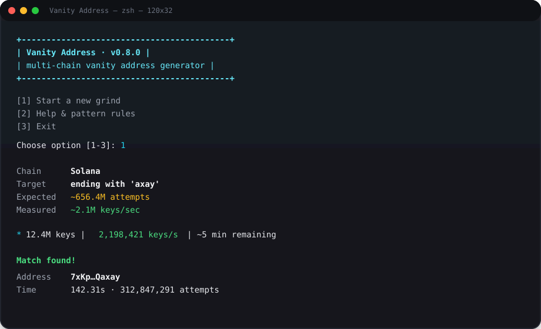
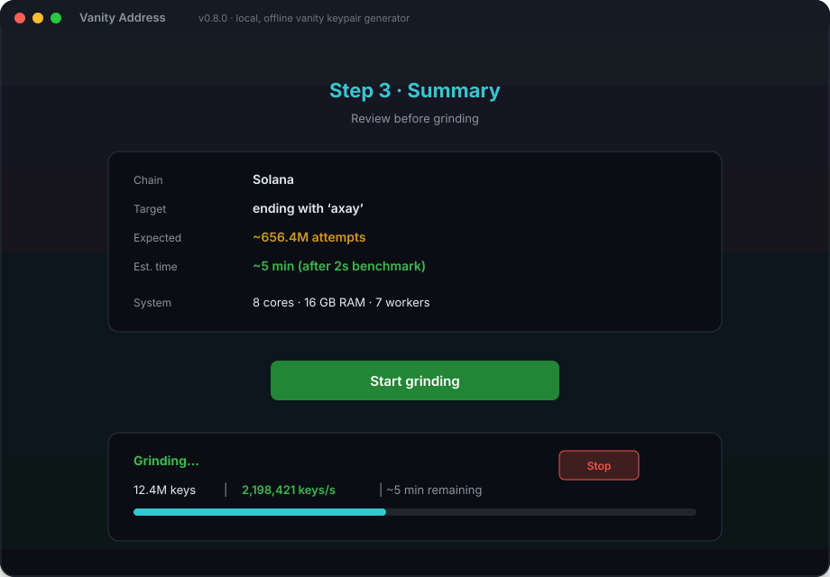

<div align="center">


# vanity-address

**Fast, local, multi-chain vanity address generator**

Generate multi-chain keypairs whose public address matches your desired prefix, suffix, and/or contains pattern — entirely on your machine. No servers. No tracking. Keys never leave your device.

**Privacy-first:** keys are generated on your device only. No accounts. No telemetry. Audit the source before you trust any vanity tool.

**No install?** [Generate in your browser →](https://vanity-address.online/generate/) — same engine, runs entirely in the tab.

<br />

[](https://github.com/yudizaxay/vanity-address/actions/workflows/ci.yml)
[](https://github.com/yudizaxay/vanity-address/releases)
[](https://crates.io/crates/vanity-address)
[](https://github.com/yudizaxay/vanity-address/blob/main/LICENSE)
[](https://github.com/yudizaxay/vanity-address/blob/main/SECURITY.md)
[](#-security)
[](#-security)
[](https://github.com/yudizaxay/vanity-address/stargazers)
[](https://github.com/yudizaxay/vanity-address/blob/main/CONTRIBUTING.md)

<br />

[Features](#-features) ·
[Demo](#-demo) ·
[Web App](#-web-app) ·
[Install](#-install) ·
[Usage](#-usage) ·
[Architecture](#-architecture) ·
[Desktop App](#-desktop-app) ·
[Security](#-security) ·
[Contributing](#-contributing)

</div>

---

## ✨ Features

| Feature                     | Solana | EVM | Tron |
| --------------------------- | :----: | :-: | :--: |
| Prefix / suffix / contains  |   ✅   | ✅  |  ✅  |
| Parallel CPU grinding       |   ✅   | ✅  |  ✅  |
| Contract vanity (CREATE · nonce 0) | — | ✅ `evm-contract` | ✅ `trx-contract` |
| CREATE2 salt vanity         |   —    | ✅ `--create2` / SDK | — |
| Token mint vanity           | ✅ `sol-mint` | — | — |
| 100% offline / local        |   ✅   | ✅  |  ✅  |

**44 wallet chains** + **4 deploy modes** (`evm-contract`, `trx-contract`, `sol-mint`, `create2`) · **CLI + desktop + npm SDK** · **web app** (wallets) · **MIT** · keys never leave your machine

> **0.8.0 in tree:** OpenCL GPU for **EVM** (~90× CPU on Apple M4; other GPUs untested) and experimental Solana — CLI/desktop — via `--gpu auto`, `gpu devices` / `gpu bench`, with CPU re-verify; Bitcoin-family forks, puzzle mode, split-key, security model. Web/npm stay CPU-only (no GPU, puzzle, or split-key). See [CHANGELOG](https://github.com/yudizaxay/vanity-address/blob/main/CHANGELOG.md) · [BENCHMARKS](https://github.com/yudizaxay/vanity-address/blob/main/docs/BENCHMARKS.md).

---

## 🎬 Demo

<p align="center">
  
</p>

<p align="center">
  
</p>

<p align="center">
  <sub>CLI interactive menu or <strong>Vanity Address</strong> desktop app — chain wizard → live benchmark → grind → export keys</sub>
</p>

---

## 🌐 Web App

**[vanity-address.online/generate](https://vanity-address.online/generate/)** — nothing to install. Works in recent Chrome, Firefox, Safari, and Edge.

```text
Pick a chain → type your word → generate → save
```

**Guides & tools** (how addresses work, valid characters, time estimates):
[Solana](https://vanity-address.online/solana-vanity-address/) · [Ethereum](https://vanity-address.online/ethereum-vanity-address/) · [Bitcoin](https://vanity-address.online/bitcoin-vanity-address/) · [CREATE2](https://vanity-address.online/create2-vanity-address/) · [Tron](https://vanity-address.online/tron-vanity-address/) · [TON](https://vanity-address.online/ton-vanity-address/) · [all chains](https://vanity-address.online/chains/) · [difficulty calculator](https://vanity-address.online/vanity-address-difficulty/)

| | Web app |
| - | - |
| All 49 chains, prefix / suffix / contains, `*` wildcards, comma OR | ✅ |
| Same Rust engine (WebAssembly) on all your CPU cores | ✅ |
| Difficulty estimate measured on your device | ✅ |
| Keys blurred until shown · copy · download as text | ✅ |
| Cookies, analytics, or third-party requests | ❌ none |
| Works offline once loaded (turn off Wi-Fi if you like) | ✅ |
| Contract / token-mint / CREATE2 modes | ✅ Address / Contract header toggle |
Keys exist only in the open tab and are never stored or sent anywhere. The device remembers just two things in `localStorage`: your theme and that you've read the safety notice. The page ships a strict Content-Security-Policy that blocks any outside connection. For large balances, prefer the offline CLI or desktop app.

---

## 📦 Install

**[Download from GitHub Releases](https://github.com/yudizaxay/vanity-address/releases/latest)** — no Rust or Node.js required.

| I want… | My computer | File |
| ------- | ----------- | ---- |
| **No install** | Any modern browser | [Web app](https://vanity-address.online/generate/) |
| **Desktop app** | Mac M1–M4 | `VanityAddress-*-Mac-AppleSilicon-Desktop.dmg` |
| **Desktop app** | Windows 10/11 | `VanityAddress-*-Windows-Desktop.exe` |
| **CLI** | Mac M1–M4 | `VanityAddress-*-Mac-AppleSilicon-CLI.tar.gz` |
| **CLI** | Mac Intel | `VanityAddress-*-Mac-Intel-CLI.tar.gz` |
| **CLI** | Windows | `VanityAddress-*-Windows-CLI.zip` |
| **CLI** | Linux | `VanityAddress-*-Linux-CLI.tar.gz` |

**Quick start (Linux):**

```bash
# Replace 0.7.0 if a newer release exists: https://github.com/yudizaxay/vanity-address/releases/latest
curl -LO https://github.com/yudizaxay/vanity-address/releases/download/v0.8.0/VanityAddress-0.8.0-Linux-CLI.tar.gz
tar xzf VanityAddress-0.8.0-Linux-CLI.tar.gz
./vanity-address
```

```bash
# Homebrew 6+: trust the tap once, then install (builds from source; requires Rust)
brew tap yudizaxay/tap && brew trust yudizaxay/tap && brew install vanity-address

# Or install via npm (pre-built binary; Node.js 18+)
npm install -g vanity-address
# npx vanity-address

# Or install the CLI from crates.io (requires Rust; first compile often takes 3–8 min)
cargo install vanity-address
```

> **Faster?** Skip compiling — download the pre-built CLI from [Releases](https://github.com/yudizaxay/vanity-address/releases/latest) (~30s).  
> **Remove later?** `cargo uninstall vanity-address` — see [Install guide → Uninstall](https://github.com/yudizaxay/vanity-address/blob/main/docs/INSTALL.md#uninstall).

> macOS may block unsigned apps — see [Install guide → Gatekeeper](https://github.com/yudizaxay/vanity-address/blob/main/docs/INSTALL.md#macos-gatekeeper-damaged-app).  
> Windows SmartScreen may warn — **More info → Run anyway**. Desktop app needs [WebView2](https://github.com/yudizaxay/vanity-address/blob/main/docs/INSTALL.md#windows--desktop-app-installer) (usually already on Windows 11).

📖 **Full guide:** [docs/INSTALL.md](https://github.com/yudizaxay/vanity-address/blob/main/docs/INSTALL.md) — per-platform steps, `.dmg` / Windows installer, checksums, Homebrew, crates.io, build from source

---

## 🚀 Usage

### Interactive mode (default)

```bash
vanity-address
```

Wizard flow: **chain → match kind → pattern → estimate → confirm → grind**.

### Direct mode

```bash
vanity-address --chain sol --suffix axay
vanity-address --chain evm --prefix dead --suffix face -q
vanity-address --chain sol --contains pump --count 3
vanity-address --chain sol --suffix moon,pump,dao
vanity-address --chain btc-segwit --suffix cafe
vanity-address --chain robinhood --suffix dead
vanity-address verify --chain sol --address <addr> --key <hex-or-base58>
vanity-address --create2 --deployer 0x… --init-code-hash 0x… --prefix cafe
vanity-address --chain evm-contract --prefix cafe   # contract address (CREATE, deployer nonce 0)
vanity-address --chain trx-contract --prefix Cafe   # Tron contract (CREATE, nonce 0)
vanity-address --chain sol-mint --suffix pump       # SPL token mint keypair
vanity-address --chain hyperliquid --prefix dead    # HyperEVM (also: sonic, base, monad, …)
```

### Common flags

| Flag              | Description                              |
| ----------------- | ---------------------------------------- |
| `--chain <ID>`    | Wallet (`sol`, `evm`, `trx`, …) or deploy mode (`evm-contract`, `trx-contract`, `sol-mint`) |
| `--prefix` / `--suffix` / `--contains` | Match start, end, or anywhere (`*` OK) |
| `--create2`       | EVM CREATE2 salt grind (needs `--deployer` + `--init-code-hash`) |
| `--deployer` / `--init-code-hash` | CREATE2 factory address + keccak256(init code) |
| `--count N`       | Find N matches                           |
| `--json`          | Machine-readable output (scripts)        |
| `--save`          | Append keys to `vanity-results.txt` (owner-only `0600` on macOS/Linux) |
| `-q, --quiet`     | Minimal output for scripts               |

### Contract & token addresses (deploy modes)

Use these when you want a **vanity contract** or **token mint**, not a wallet.

| Mode | Flag / chain | What you grind | Tip |
| ---- | ------------ | -------------- | --- |
| EVM contract | `--chain evm-contract` | Deployer key → contract at nonce 0 | First tx on that chain **must** be the deploy |
| Tron contract | `--chain trx-contract` | Deployer key → `T…` contract at nonce 0 | Same rule as EVM |
| EVM CREATE2 | `--create2 --deployer 0x… --init-code-hash 0x…` | Salt for a known factory | Output is a **salt**, not a private key |
| Solana mint | `--chain sol-mint` | Mint keypair | Save JSON → `spl-token create-token mint.json` |

```bash
# EVM CREATE (nonce 0) — fund the deployer, deploy as its first transaction
vanity-address --chain evm-contract --prefix cafe

# Tron CREATE (nonce 0)
vanity-address --chain trx-contract --prefix Cafe

# EVM CREATE2 — you already have the factory + init-code hash
vanity-address --create2 --deployer 0xYourFactory… --init-code-hash 0x… --prefix cafe

# Solana token mint
vanity-address --chain sol-mint --suffix pump
# → save "Mint Keypair (JSON)" as mint.json, then:
spl-token create-token mint.json
```

Interactive CLI: after the A–Z wallet list, digit keys pick deploy modes (CREATE2 stays `--create2` because it needs factory params). Desktop app: same modes under **Deploy / mint**, with CREATE2 fields on the pattern screen.

📖 **Full guide:** [docs/USAGE.md](https://github.com/yudizaxay/vanity-address/blob/main/docs/USAGE.md) — all chains, deploy modes, JSON schema, pattern rules, performance tips

---

## 📦 Use it in your own code

`npm install vanity-address` — programmatic API via WebAssembly (Node: multi-core workers by default):

```js
const {
  generateAddress,
  estimateDifficulty,
  listChains,
  listDeployModes,
} = require("vanity-address");

listDeployModes();
// [{ id: "evm-contract", needsFactory: false }, … { id: "create2", needsFactory: true }]

const wallet = await generateAddress({ chain: "evm", prefix: "abc", workers: 4 });
console.log(wallet.address, wallet.privateKey);

// EVM / Tron contract (CREATE · nonce 0)
const contract = await generateAddress({ chain: "evm-contract", prefix: "cafe" });
// contract.address = vanity contract; contract.privateKey = deployer key

// CREATE2 salt (needs factory params)
const { address, privateKey: salt } = await generateAddress({
  chain: "create2",
  prefix: "cafe",
  deployer: "0xYourFactory…",
  initCodeHash: "0x…", // keccak256(init code)
});
```

Also: `generateAddresses`, `validatePattern`, `isValidChain`, `timeoutMs`, rich `onProgress`.

📖 **Full guide:** [docs/SDK.md](https://github.com/yudizaxay/vanity-address/blob/main/docs/SDK.md) — API reference, deploy modes, workers, progress/ETA

---

## 🏗 Architecture

```text
┌───────────────────┐   ┌─────────────────────┐
│  vanity-address   │   │    vanity-app       │
│      (CLI)        │   │  (Tauri desktop UI) │
├───────────────────┴───┴─────────────────────┤
│                vanity-core lib              │
│  ┌────────┐ ┌─────┐ ┌──────────┐ ┌───────┐  │
│  │ Solana │ │ EVM │ │ Bitcoin… │ │  +28  │  │
│  │Grinder │ │Grind│ │ Grinders │ │ more  │  │
│  └────────┘ └─────┘ └──────────┘ └───────┘  │
│              ChainGrinder trait             │
└─────────────────────────────────────────────┘
```

New chain = one file + trait implementation in `vanity-core/src/chains/`. CLI and desktop UI are thin frontends over the same engine — no duplicated chain logic. The web app and npm SDK run the same engine compiled to WebAssembly (`vanity-wasm/`).

---

## 🖥 Desktop App

**Vanity Address** (`vanity-app/`) — native Tauri UI wired directly to `vanity-core`.

```text
Home → Chain → Pattern → Summary → Grind → Result
```

| Feature | Desktop |
| ------- | ------- |
| 44 wallet chains, live ETA, stop mid-grind | ✅ |
| Deploy / mint modes (`evm-contract`, `trx-contract`, `sol-mint`, CREATE2) | ✅ |
| Impractical-pattern warning | ✅ |
| Masked keys + reveal / copy / save | ✅ |

**Install:** download the Mac `.dmg` or Windows `.exe` from [Releases](https://github.com/yudizaxay/vanity-address/releases/latest) — see [docs/INSTALL.md](https://github.com/yudizaxay/vanity-address/blob/main/docs/INSTALL.md).

**Build from source:** `cd vanity-app && npm install && npm run tauri dev`

---

## 🔐 Security

> **⚠️ Read before generating keys** — this is a **key generator**, not a wallet, and it is **not formally audited**.
>
> | Rule         | Detail                                                  |
> | ------------ | ------------------------------------------------------- |
> | Local only   | Keys are generated on **your machine**                  |
> | No network   | This tool **never connects to the internet** while grinding |
> | Web app      | Loads once, then generates in the tab — no cookies, no uploads, strict CSP |
> | Never share  | **Do not** share private keys with anyone               |
> | Large funds  | Prefer offline CLI/desktop; treat saves/downloads as plaintext secrets |
> | Verify first | Always double-check the address before sending funds    |
> | Saved keys   | `--save` files are owner-only (`0600`) on macOS/Linux; secrets are wiped from memory after use |
> | Open source  | Audit the code — trust, but verify                      |

Policy: [SECURITY.md](https://github.com/yudizaxay/vanity-address/blob/main/SECURITY.md) · Threat model: [docs/SECURITY-MODEL.md](https://github.com/yudizaxay/vanity-address/blob/main/docs/SECURITY-MODEL.md)

---

## 🤝 Contributing

Contributions welcome — new blockchains, bug fixes, features, docs, and tests.

Before opening a PR:

```bash
make check-ci
```

📖 **[CONTRIBUTING.md](https://github.com/yudizaxay/vanity-address/blob/main/CONTRIBUTING.md)** — add a chain, PR checklist, project structure

| Want to… | Start here |
|----------|------------|
| Add a blockchain | `vanity-core/src/chains/` + [contributing guide](https://github.com/yudizaxay/vanity-address/blob/main/CONTRIBUTING.md#adding-a-new-blockchain) |
| Fix a bug | Fork → branch → PR with repro steps |
| Propose a feature | [Open a feature request](https://github.com/yudizaxay/vanity-address/issues/new?template=feature_request.yml) |

---

## 📄 License

**[MIT License](https://github.com/yudizaxay/vanity-address/blob/main/LICENSE)** — free for personal and commercial use.

---

<div align="center">

**Built with 🦀 Rust** · Keys stay on your machine

<br />

[](https://github.com/yudizaxay/vanity-address)
[](https://github.com/yudizaxay/vanity-address/issues/new?template=bug_report.yml)
[](https://github.com/yudizaxay/vanity-address/issues/new?template=feature_request.yml)

<br />

<sub>If this project helped you, consider giving it a ⭐ on GitHub!</sub>

</div>
